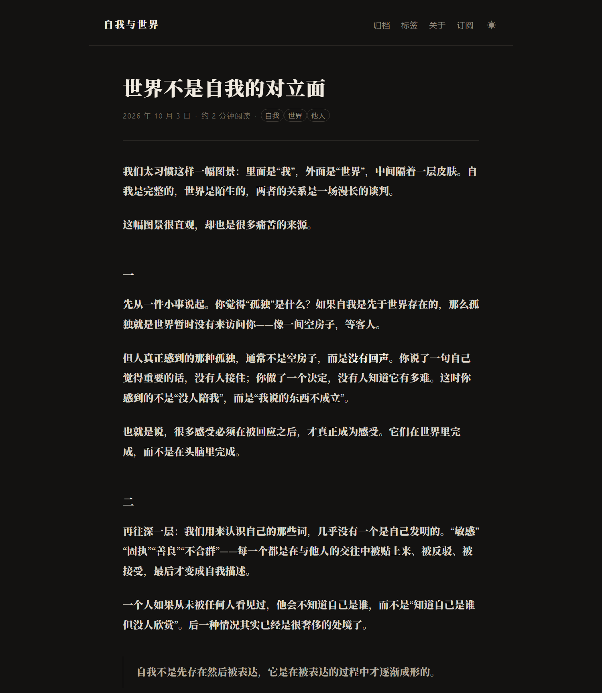

# 自我与世界 · 一个静态博客

一个**零依赖**的中文静态博客：文章用 Markdown 写，`node build.mjs` 一条命令生成整站，
产物是纯 HTML/CSS，丢给任何静态托管即可。构建时需要的东西只有一个已放进
`vendor/` 的 Markdown 解析器（[marked](https://github.com/markedjs/marked)，MIT），
所以**不需要 `npm install`，也不需要联网**。




> 想改内容但不确定动哪个文件？看 **[编辑指南.md](编辑指南.md)** —— 写文章、改配色、改页脚文案都有对应的位置和行号。

## 快速开始

```powershell
# 1. 生成站点（产物在 dist/）
node build.mjs

# 2. 本地预览（零依赖的小服务器，自带 404 页）
node serve.mjs
#   然后打开 http://localhost:8000
```

> 只在本机看的话，后台挂着 `node serve.mjs` 就够了，不需要任何托管。
> 想直接看文件也行：双击 `dist\index.html`，只是 `file://` 协议下和正式托管略有差别
> （比如页内链接、404 页行为），平时写东西建议还是用 `node serve.mjs`。

> Windows PowerShell 默认禁止运行 `npm.ps1`，所以这里全程不用 npm —— 用 `node` 直接跑即可。
> 如果你更习惯 npm，`npm run build`、`npm start` 和 `npm run new "标题"` 也配好了。

## 目录结构

```
blog/
├── build.mjs              # 生成器：Markdown → 首页/文章/归档/标签/RSS/sitemap
├── new-post.mjs           # 新建文章的小工具
├── site.config.mjs        # 站点标题、作者、域名等配置（先改这里）
├── content/
│   ├── posts/*.md         # 文章：一个文件一篇
│   └── about.md           # 关于页
├── static/                # 原样复制到 dist/
│   ├── style.css          # 全部样式（含深色模式、打印样式）
│   ├── theme.js           # 手动切换深浅色
│   └── favicon.svg
├── vendor/marked.esm.js   # 已内置的 Markdown 解析器
└── dist/                  # 构建产物（已 gitignore）
```

## 写一篇新文章

```powershell
node new-post.mjs "题目：为什么我睡不着"
```

会生成 `content/posts/post-2026-10-30-2030.md`，内容长这样：

```markdown
---
title: 为什么我睡不着
date: 2026-10-30
summary: 一句话说清这篇要写什么（会出现在首页和 RSS 里）。
tags: [自我, 时间]
draft: true
---

正文从这里开始。
```

- `summary` 显示在首页列表和 RSS 摘要里，建议写。
- `tags` 用方括号、逗号分隔，会自动生成标签页。
- `draft: true` 的文章不会进构建；定稿后删掉这行（或改成 `false`）再构建。
- 可选 `slug: my-post`，用来指定 URL 文件名（默认用 `.md` 的文件名）。

改完运行 `node build.mjs`，`dist/` 就是最新站点。

## 配置与自定义

| 想改什么 | 改哪里 |
| --- | --- |
| 站名、题记、作者、域名 | `site.config.mjs` |
| 颜色、字体、行宽、间距 | `static/style.css` 顶部的 `:root` 变量 |
| 首页版式、页脚、导航 | `build.mjs` 里的 `layout()` 与 `homePage()` |
| 关于页 | `content/about.md` |

配色变量：`--bg` 纸色、`--fg` 墨色、`--accent` 强调色（浅色 `#8c3f2c`，深色 `#d68a6d`），
深色模式的同一组变量在 `@media (prefers-color-scheme: dark)` 和 `[data-theme="dark"]` 里各写了一份。

字体走系统栈：`Iowan Old Style / Georgia` + `思源宋体 / Songti SC / SimSun`，
不加载任何网络字体，国内打开也不会卡。想换成思源宋体 Web Font，在 `:root` 的
`--font-serif` 前面加一行 `@font-face` 即可。

## 可选：想公开时再部署

平时只在本地写、本地看的话，这一节可以直接跳过。真要上线再回来看。

> 国内访问的话：Cloudflare Pages / GitHub Pages 都不需要备案，但节点在境外，速度一般；
> 想要"国内机房速度"，必须走「域名 + ICP 备案 + 国内 CDN」，见文末说明。

### 方式零：Cloudflare Pages（免备案，最快上线）

**A. 网页拖拽（不用装任何工具，1 分钟）**

1. 打开 [Workers & Pages](https://dash.cloudflare.com/?to=/:account/workers-and-pages) → **Create** → **Pages** → **Upload assets**。
2. 项目名随便起（例如 `self-and-world`），把本地的 **`dist` 整个文件夹**拖进去 → **Deploy**。
3. 得到 `https://<项目名>.pages.dev`，这就是你的永久地址。

**B. 命令行（适合之后反复更新）**

```powershell
node build.mjs
npx wrangler pages deploy dist --project-name=self-and-world
```

第一次会要求登录（浏览器里点 Authorize 即可），之后一条命令就能发布新版本。

`dist/_headers` 是给 Cloudflare Pages 用的响应头配置（来自 `static/_headers`），
用来加缓存和基础安全头；其他平台会忽略它。

### 方式一：GitHub Pages（仓库里已带 workflow）

1. 把 `blog/` 里的内容放到仓库根目录，推到 GitHub（分支名 `main`）。
2. 仓库 **Settings → Pages → Build and deployment → Source** 选 **GitHub Actions**。
3. 之后每次 push 会自动跑 `.github/workflows/deploy.yml`：`node build.mjs` → 上传 `dist/` → 发布。

站点地址是 `https://<用户名>.github.io/<仓库名>/`。因为站内链接都用相对路径，
放在子路径下也能正常工作；但要把 `site.config.mjs` 里的 `url` 改成这个完整地址，
否则 RSS 和 sitemap 里的绝对链接会指向 `example.com`。

### 方式二：Vercel / Netlify

- **Build command**：`node build.mjs`
- **Output directory**：`dist`
- 无需安装依赖，无需环境变量。

### 方式三：自己的服务器 / 国内对象存储

`dist/` 是纯静态文件，直接扔进 Nginx 的站点目录即可。404 页面用 `dist/404.html`。

放在国内对象存储（阿里云 OSS、腾讯云 COS）或 EdgeOne Pages 时要注意：
使用平台的**默认域名**并不能稳定当网站用（有的会强制下载、有的只给几小时有效的预览链接），
正式上线需要绑定一个**已备案**的自定义域名。大致流程：

1. 买域名（`.com` 约 ￥60/年）→ 在境内注册商实名。
2. 个人 ICP 备案（免费，7–20 个工作日，需身份证）。
3. 备案通过后绑定到 EdgeOne Pages / OSS+CDN，解析生效即可用国内节点访问。

## 产物一览

| 路径 | 内容 |
| --- | --- |
| `index.html` | 首页（最新 N 篇，`site.config.mjs` 的 `pageSize`） |
| `posts/<slug>.html` | 文章页（含上一篇/下一篇、相关文章、JSON-LD 结构化数据） |
| `archive.html` | 按年份归档 |
| `tags.html`、`tags/<标签>.html` | 标签总览与单个标签页 |
| `about.html` | 关于页 |
| `rss.xml` | RSS 2.0 全文订阅 |
| `sitemap.xml`、`robots.txt` | 给搜索引擎的 |
| `404.html` | 404 页 |

## 小提示

- Markdown 里请用中文引号「“”」而不是英文直引号，排版更整齐。
- 段落之间空一行；单个换行不会换段（`breaks: false`）。
- 文章标题的二级标题（`## 一`）会自动生成锚点 id，可以直接分享 `#一` 这样的链接。
- 想临时预览未发布的草稿：`$env:INCLUDE_DRAFTS=1; node build.mjs`（PowerShell）。
- 站点本身没有统计、评论。要评论可以接 Giscus/Utterances（在 `build.mjs` 的文章模板里加一段 `<script>`）。

## 数据都归你

所有内容就是一堆 `.md` 文件 + 一个 `build.mjs`，没有数据库、没有供应商锁定。
哪天真要搬家，换个生成器甚至手写 HTML 都行。
